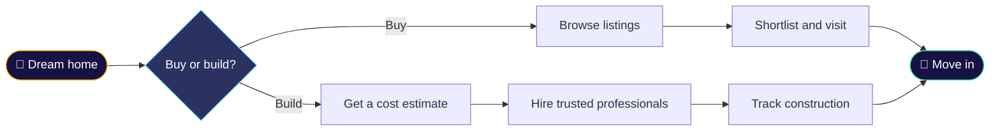

<div align="center">



<a href="https://ghartech.co">
  
</a>

<br/>


<br/>

[**The idea**](#-the-idea) ·
[**What we're building**](#-what-were-building) ·
[**How it works**](#-how-it-works) ·
[**Roadmap**](#-roadmap) ·
[**Run it locally**](#-run-it-locally) ·
[**Contribute**](#-contribute)

</div>


<div align="center">
  
</div>


## 🏠 The idea

**Ghar** (घर) means *home*. **Ghartech** is where homes meet technology.

Buying a house or building one is still slow, confusing, and full of guesswork:
scattered listings, unclear construction costs, contractors nobody can vouch for,
and projects that drift off schedule with no one watching.

Ghartech puts the whole journey in one place, from the first property search to the day you get the keys.

> **Our goal:** make buying and building a home as clear and trackable as ordering something online.

<br/>

## ✨ What we're building

<table>
<tr>
<td width="33%" valign="top">

### 🏘️ Property discovery
Search and compare listings with clear details, so you spend less time chasing brokers and more time visiting homes you actually like.

</td>
<td width="33%" valign="top">

### 💰 Cost estimator
Get a realistic construction budget before you start, broken down by material, labour, and stage.

</td>
<td width="33%" valign="top">

### 🤝 Trusted professionals
Find contractors, architects, and engineers, and see their past work and reviews before you hire.

</td>
</tr>
<tr>
<td width="33%" valign="top">

### 🏗️ Project tracking
Follow your build stage by stage with updates, photos, milestones, and payment checkpoints.

</td>
<td width="33%" valign="top">

### 📐 Plan and design
Explore layouts and ideas for your plot, then hand them to your builder without things getting lost.

</td>
<td width="33%" valign="top">

### 📄 One home file
Keep agreements, receipts, approvals, and drawings together in one organised place.

</td>
</tr>
</table>

> 💡 *These are the ideas we're shaping the MVP around. They will change as we talk to real homebuyers and builders.*

<br/>

## 🧭 How it works



<br/>

## 🚧 Roadmap

We're building in the open. Here's where things stand:

- [x] 💡 Idea and name locked in: **Ghartech**
- [ ] 🌐 Register the domain: **ghartech.co**
- [ ] 🎨 Brand identity and logo
- [ ] 🧱 Landing page with waitlist
- [ ] 🏘️ Property listings (MVP)
- [ ] 💰 Construction cost estimator (MVP)
- [ ] 🤝 Professional profiles and reviews
- [ ] 🏗️ Project tracking dashboard
- [ ] 📱 Mobile-friendly release
- [ ] 🚀 Public launch

<details>
<summary><b>👀 Where the work is happening right now</b></summary>

<br/>

| Area | Status |
| :-- | :-- |
| Product idea and research | 🟢 In progress |
| Landing page | 🟡 Up next |
| Core platform (auth, listings) | ⚪ Planned |
| Cost estimator | ⚪ Planned |
| Project tracking | ⚪ Planned |

</details>

<br/>

## 🧰 Tech stack

> ✏️ *Swap these badges for whatever you end up using.*


<br/>

<details>
<summary><b>📁 Project structure</b></summary>

```text
ghartech/
├── assets/            # README banner and animations
├── client/            # Frontend app
├── server/            # Backend API
├── docs/              # Product notes and designs
├── .env.example
└── README.md
```

</details>

<br/>

## 🤝 Contribute

Ghartech is early, and that's the best time to get involved.

1. **Fork** the repo
2. **Create a branch**: `git checkout -b feature/your-idea`
3. **Commit** your changes: `git commit -m "Add your idea"`
4. **Push** and open a **Pull Request**

Not a developer? Ideas, feedback, and stories from people who have bought or built a home are just as valuable. Open an **Issue** and tell us what went wrong for you.

<br/>

## 📬 Stay in the loop

- 🌐 Website: **[ghartech.co](https://ghartech.co)** *(coming soon)*
- ⭐ **Star this repo** to follow along as we build
- 🐛 Found a bug or have an idea? [Open an issue](../../issues)

<br/>

<div align="center">

**Built brick by brick, byte by byte.**


</div>
